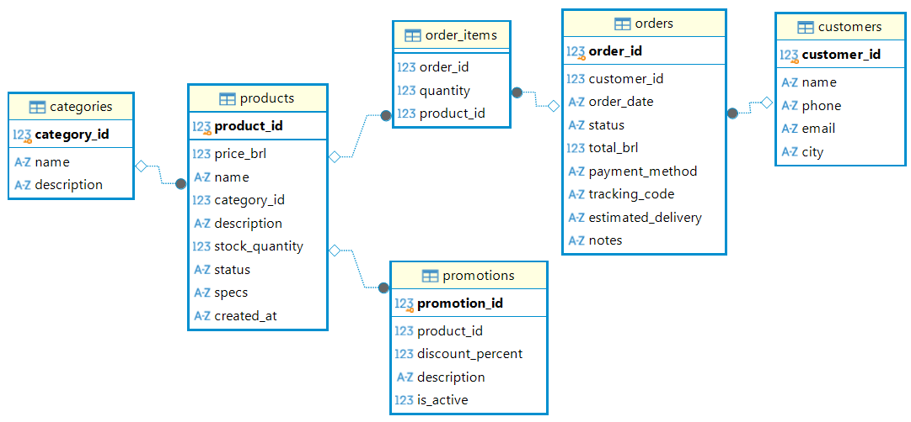

# emporio-musica-ai-agent
Customer service AI agent prototype for Empório da Música (Artefact AI Engineer Case)

## Prerequisites & System Requirements

### Prerequisites
- **Python**: Version `3.10` or higher (Tested and developed using `Python 3.14.8`)
- **Environment Management**: `venv` (built-in Python virtual environment)
- **Package Manager**: `pip`

## Database Entity-Relationship Model

To establish a clear understanding of the business context and support the agent's data retrieval capabilities, the operational data was modeled into a relational schema:

Mapping the relationships between entities is the foundational step in consolidating the core business logic. By defining primary keys and table relationships, we can effectively trace customer journeys, query order statuses, check real-time stock, and anticipate complex customer inquiry scenarios.

## Architectural Decisions: 

### Data Layer (`scr/database.py`)

- **In-Memory SQLite Engine**: Operational CSV files (`categories`, `customers`, `orders`, `order_items`, `products`, `promotions`) are ingested into an in-memory SQLite database (`:memory:`) upon application startup. This provides zero-dependency, fast SQL querying for function-calling tools.
- **Categorical ID Handling**: Identifier fields (`customer_id`, `order_id`, `product_id`, `category_id`, `promotion_id`) are explicitly treated as string dimensions rather than numeric metrics. This prevents unintended mathematical aggregations and ensures consistency across LLM function calls.
- **Relational Integrity**: While SQLite ingests raw CSV DataFrames, relational joins (`JOIN` queries on primary and foreign keys) are enforced directly within the Python analytical tools used by the agent to ensure accurate data extraction.

### Policy Retrieval Layer (`scr/tools.py`)

- **Lightweight Document Ingestion**: Utilizes `pypdf` to extract and clean text page-by-page from `data/politicas_da_loja.pdf`. This eliminates the need for heavy external vector database servers, keeping runtime dependencies minimal and fast execution.

- **Stem-Based Relevance Retrieval**: Implements keyword tokenization with basic word stem matching (e.g., handling singular/plural query variations like `garantia` / `garantias`). The engine scores and returns the top $k$ relevant policy pages (`top_k=2`) to provide complete contextual coverage for edge cases spanning page breaks.

- **Separation of Concerns (Prompt vs. Retrieval)**: Static agent behavior, tone of voice, greeting structure, and store boundaries (Section 7 of store policies) are defined directly inside the Agent System Prompt for deterministic adherence. Dynamic fact-based rules (e.g., return windows, store address, payment rules, and warranty terms) are queried on demand via `search_store_policies()`.

### Agent Persona & Orchestration Layer (`src/agent.py`)

- **Policy-Grounded System Prompt**:  Incorporates Section 7 store policy guidelines directly into the agent's core instructions. Enforces a warm, music-focused persona ("knowledgeable friend"), a structured 5-step customer service flow, strict catalog boundaries (excluding accessories and redirecting to a partner), and deterministic protocols for out-of-stock items, expired promotions, and complaint handling (24 business hours SLA).

- **Relational Schema Awareness & SQL Joins**:  Embeds explicit database ER schema documentation directly inside the system prompt and provides specialized Python tools executing multi-table JOIN queries (e.g., joining orders, order_items, and products, or promotions and products) to ensure precise relational context retrieval.

- **Dynamic Intent Routing**: Implements query intent classification in `EmporioAgent` to route user inquiries to the appropriate context provider (SQL database for stock/orders vs. PDF RAG for store rules).

- **LLM Payload Construction**: Assembles complete context payloads combining system instructions, dynamically retrieved data (SQL/PDF), and customer messages into a unified prompt structure ready for downstream LLM API inference.